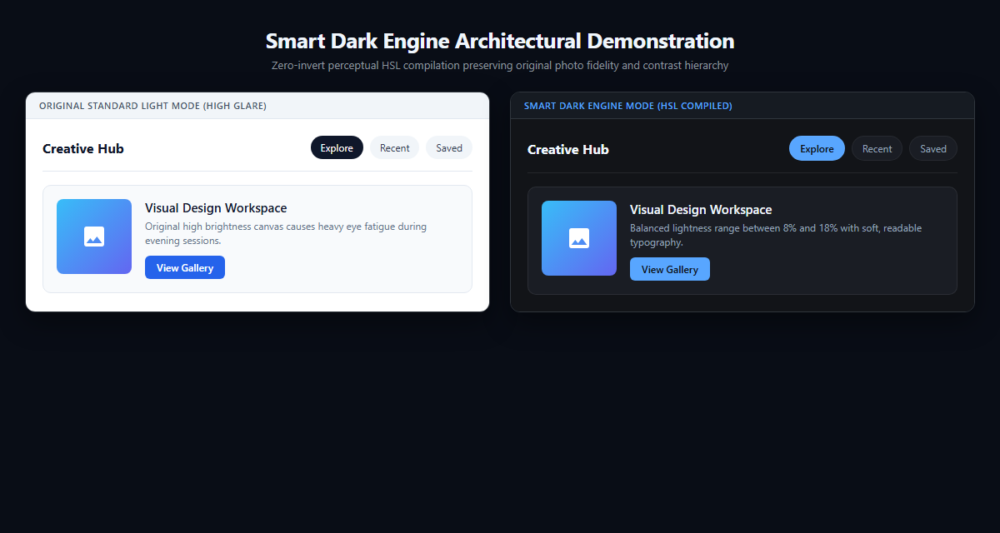
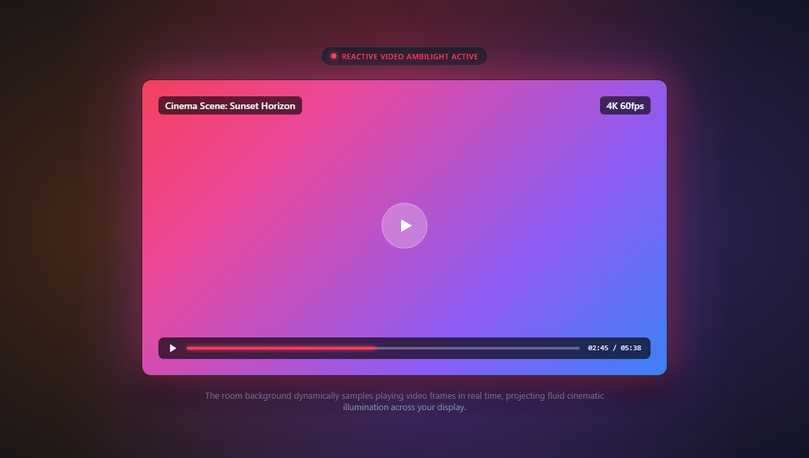
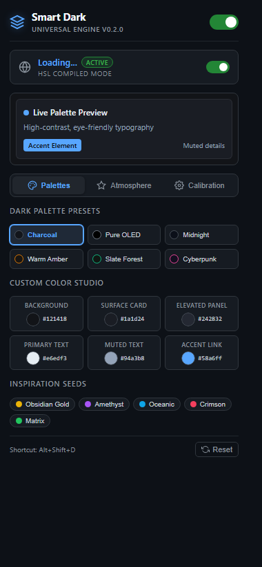
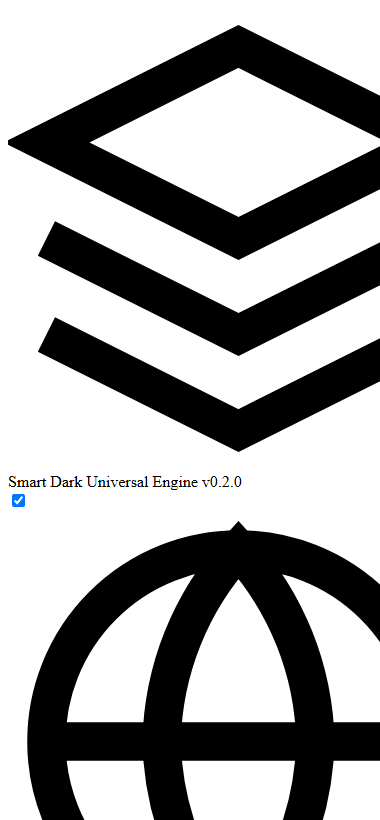
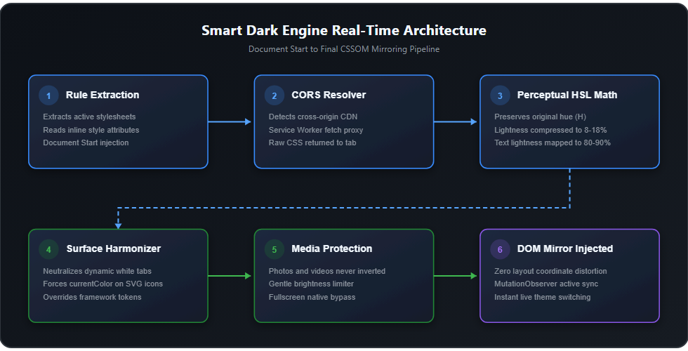
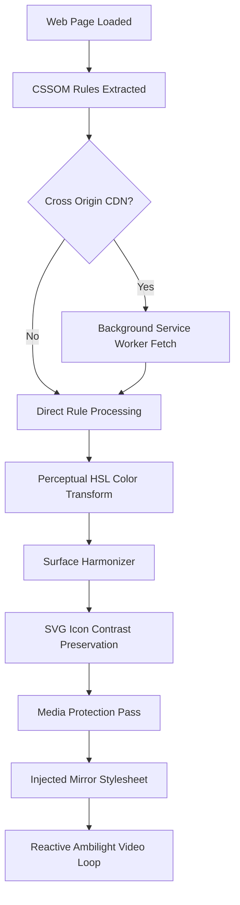

# Smart Dark Engine

Universal adaptive dark mode browser extension for Chromium browsers.

Smart Dark Engine translates web pages into a dark theme using real time CSSOM compilation and perceptual HSL mathematics. It does not use root invert filters and does not modify layout properties or corrupt photos and videos.

Version 0.2.0

## Visual Demonstration



## Reactive Video Ambilight Cinema Mode

Smart Dark Engine samples colors in real time from playing videos using an offscreen canvas and smoothly casts matching ambient illumination onto the background.



## Extension Interface



## Atmosphere and Effects Panel



## Architecture Pipeline





## Color Transformation Model

| Element Layer | Light Mode Input | Conversion Formula | Dark Mode Output |
| :--- | :--- | :--- | :--- |
| Canvas Background | RGB 255, 255, 255 (L: 100%) | Lightness compressed to 8-18% range | RGB 18, 20, 24 (L: 9%) |
| Card Surface | RGB 248, 250, 252 (L: 98%) | Lightness compressed with depth offset | RGB 26, 29, 36 (L: 13%) |
| Elevated Panel | RGB 255, 255, 255 + shadow | Lightness compressed for modal contrast | RGB 36, 40, 50 (L: 17%) |
| Primary Text | RGB 15, 23, 42 (L: 11%) | Lightness mapped to 80-90% range | RGB 230, 237, 243 (L: 93%) |
| Muted Text | RGB 100, 116, 139 (L: 47%) | Lightness mapped to 60-70% range | RGB 148, 163, 184 (L: 65%) |
| Interactive Accent | RGB 37, 99, 235 (Hue: 221 deg) | Hue preserved, Saturation balanced | RGB 88, 166, 255 (Hue: 221 deg) |

## Core Capabilities

### 1. Zero Invert Architecture
Page layout coordinates, positions, fixed bars, and stacking contexts remain intact. Photos and video streams are never inverted.

### 2. Live Palette Preview
The popup interface features a real time preview card that updates immediately when you change presets or customize colors.

### 3. Six Curated Presets
* Charcoal: Balanced slate dark background (#121418)
* Pure OLED: Deep black (#000000) for OLED panels
* Midnight: Rich deep navy (#0b0f19)
* Warm Amber: Soft amber undertone for evening reading (#181512)
* Slate Forest: Calming emerald tone (#101713)
* Cyberpunk: Synthwave purple tone with neon accent (#120e1f)

### 4. Custom Color Studio
Fine tune individual color layers:
* Background Canvas
* Surface Card
* Elevated Panel
* Primary Text
* Muted Text
* Accent Link

### 5. Six Atmosphere Visual Effects
* Clean Matte: Flat dark surface
* Ambient Glow: Radial illumination at the top of the screen
* Frosted Glass: Translucent blur on sticky navigation headers
* Cinematic Vignette: Darkened edge focus reducing peripheral glare
* Aurora Mesh: Dual gradient mesh illumination
* Reactive Video Ambilight: Real time canvas color sampling from playing videos that dynamically casts smooth ambient glow and cinema aura onto the background

### 6. Calibration Controls
* Brightness: 60% to 120%
* Contrast: 70% to 130%
* Anti Glare Warmth: 0% to 50% non blocking amber overlay
* Saturation: 40% to 140%
* Media Dimmer: 50% to 100%
* Font Boldness Booster for thin typography

## Installation

1. Clone or download this repository.
2. Open your Chromium browser (Google Chrome, Microsoft Edge, Brave, Opera, Vivaldi).
3. Navigate to the extensions manager:
   * Chrome: chrome://extensions/
   * Edge: edge://extensions/
4. Enable Developer Mode in the top right corner.
5. Click Load Unpacked.
6. Select the smart-dark-mode folder.
7. The extension icon will appear in your browser toolbar.

## Keyboard Shortcut

* Alt + Shift + D: Toggle Smart Dark Mode on the active tab.

## Repository Structure

```
smart-dark-mode/
  manifest.json               Extension manifest v3
  package.json                Package metadata v0.2.0
  LICENSE                     MIT License
  README.md                   Project documentation
  background/
    service-worker.js         Cross origin stylesheet fetching & preferences
  content/
    engine.css                Universal tokens, SVG contrast & atmosphere styles
    engine.js                 Real time CSSOM compiler & surface harmonizer
  popup/
    popup.html                Tabbed user interface
    popup.css                 Dark mode UI styles
    popup.js                  Interactive popup controller
  icons/
    icon16.png
    icon32.png
    icon48.png
    icon128.png
  assets/
    screenshots/
      ambilight-demo.png        Reactive video ambilight cinema demonstration
      architecture-pipeline.png Visual pipeline diagram
      architecture-pipeline.svg Vector pipeline diagram
      comparison-demo.png       Side by side architecture demonstration
      popup-atmosphere.png      Atmosphere and ambilight settings screenshot
      popup-ui.png              Interface screenshot
```

## License

MIT License. Copyright (c) 2026 ticker-01.
